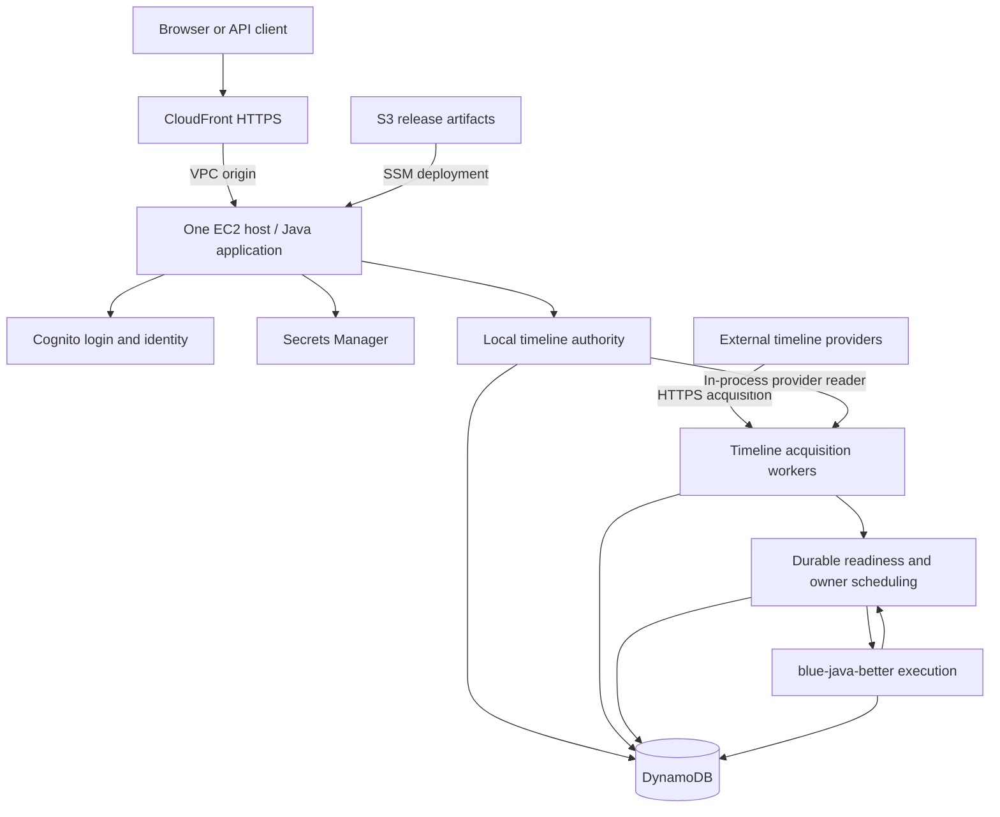

# First operation after restart: measured explanation and deployed architecture

Date: 2026-11-10. Preview: https://d2buikczdox1rt.cloudfront.net

The approximately 5.42-second observation was **not a measurement of package loading**. Runtime/package configuration finishes before the application becomes healthy and before this operation is submitted. A new trace reproduced the public operation in 5.454 and 5.815 seconds. It exposes substantial host work before the Payment starts executing, including an unnecessary broad subscription-metadata path for locally appended operations.

The exact historical 5.416-second run did not record all these phases. Its missing intervals cannot be reconstructed retroactively. The figures below are new, directly measured reproductions on the existing 100-Order synthetic graph. They establish where the same kind of delay occurs; they are not invented subdivisions of the older measurement.

## What changed in this investigation

Added optional Java Flight Recorder events for request handling, authentication, operation authorship/append/notification, source acquisition, individual storage calls, owner processing, and runtime configuration. Existing owner execution events remain available. Event fields contain identifiers and phase names, not document payloads, credentials, cookies, or secret values.

Added a bounded restart-and-trace script, an analyzer that preserves nesting and overlapping intervals, and a read-only timeline-subscription inspector. Business semantics, gas calculation, ordering, and scheduling behavior were not changed by this diagnostic deployment. In particular, the broad local-append scheduling path described below is **identified, not fixed** in this iteration.

The application suite passed: **841 tests, zero failures/errors/skips**, followed by format checking and compilation of the additional read-only qualification tool. This investigation did not rerun the full library or local-environment suites. The traced deployment archive SHA-256 is `b6c62ef537cc56c834dbda71af4605839fb3699518fb5233a2116466341f58e1`. The temporary profiling configuration was removed, recording stopped, and service health checked by SSM after the runs.

## Reproduction and correctness checks

Two service restarts; after each restart, one cold operation and one following warm operation. Login and baseline document reads happen before the restart. The timer begins when the client submits the operation after health is available. Background source acquisition is active, so “cold” means first business operation in a fresh JVM, not a guarantee that every cache is still empty.

The operation targets one Payment in the existing Agreement with 100 Orders. It increments the Payment's recorded amount by 42, then updates its Order and the Agreement. The driver verifies all three values and the matching Agreement history entry for the exact submitted entry. All four calls passed. Agreement versions progressed from 7 to 11; totals were 294, 336, 378, and 420. Each retained Agreement outcome reports gas 224 under this fixture's explicitly pinned additive prototype schedule. This fixture does not establish new compositional-gas parity; that is covered by separate audit evidence.

| Restart round | Operation | Client submit to observed history | Server arrival to Agreement completion | Server POST handling | Three owner execution events combined |
|---|---|---:|---:|---:|---:|
| 1 | Cold | 5,454.01 ms | 4,725.41 ms | 1,487.11 ms | 1,508.53 ms |
| 1 | Warm | 2,614.44 ms | 1,807.08 ms | 268.80 ms | 548.84 ms |
| 2 | Cold | 5,814.82 ms | 4,836.04 ms | 1,375.88 ms | 1,515.34 ms |
| 2 | Warm | 2,650.84 ms | 1,885.25 ms | 317.97 ms | 577.28 ms |

These runs had JFR profiling enabled and are diagnostic samples, not a new latency distribution or replacement for the earlier unprofiled qualification campaign. Different earlier warm results must not be mixed with these samples as though their measurement conditions were identical.

## The first cold operation, step by step

Times below use the server's monotonic event intervals, relative to arrival of the operation POST. Agreement completion is the end of its successful execution event immediately following publication; it is not the client seeing the result.

1. **0–334 ms: authenticate and construct the operation.** The first authentication scope took 154.46 ms; a second scope was 0.73 ms. Operation authorship took 166.74 ms. Routing and request preparation occupy the remainder. The driver was already logged in: this is request authentication, not an interactive login.
2. **334–1,477 ms: append the local timeline entry, prepare scheduling metadata, and publish.** The measured append scope was 1,143.50 ms. It includes preparation/signing/content work and storage publication, as well as the scheduling path described below. The trace does not isolate the subscriber loop itself, so the entire 1,143.50 ms must not be attributed to that loop alone.
3. **1,477–3,047 ms: acquire usable timeline evidence and reach a ready owner.** Notification completes at approximately 1,481 ms. The operation's own source acquisition runs from 1,539 to 2,213 ms (674.30 ms). The provider access-control source is acquired from 2,591 to 2,923 ms (332.36 ms). The remaining portions include dispatch, source readiness, claim preparation, and gaps between those phases. Other source acquisitions run concurrently; their durations cannot simply be added to elapsed time. These measurements locate the work and gaps, but do not fully distinguish CPU scheduling from storage wait in every gap.
4. **3,047–3,892 ms: process Payment, including storage.** Whole processing scope: 845.61 ms.
5. **3,954–4,262 ms: adopt the Payment result and process Order, including storage.** Whole processing scope: 308.47 ms.
6. **4,339–4,725 ms: adopt the Order result and process Agreement, including storage.** Whole processing scope: 386.85 ms.
7. **The client observes the committed history at 5,454 ms on its own timer.** Request transit plus observation overhead accounts for the approximately 729 ms difference from the server interval. This is a difference between durations, not synchronized one-way network timestamps: it includes both before-arrival transit and after-completion observation.

The following non-overlapping accounting covers the 5.454-second client observation:

| Interval | Duration |
|---|---:|
| Server request arrival to append start | 333.61 ms |
| Append | 1,143.50 ms |
| Append end to Payment processing start | 1,569.68 ms |
| Payment start through Agreement completion, including inter-owner gaps | 1,678.62 ms |
| Client transit/observation residual | 728.60 ms |
| **Total** | **5,454.01 ms** |

Inside the three older owner execution events:

| Phase | Payment | Order | Agreement |
|---|---:|---:|---:|
| Restore | 46.36 ms | 39.51 ms | 40.83 ms |
| Admission | 270.06 ms | 44.34 ms | 30.81 ms |
| Execution scope | 231.76 ms | 42.41 ms | 100.83 ms |
| Preparation | 146.85 ms | 77.25 ms | 122.88 ms |
| Commit | 131.69 ms | 96.97 ms | 85.32 ms |

“Execution scope” is elapsed time around the runtime invocation and can include lazy resource reads. It is not a CPU-only BEX measurement. Whole owner-processing events additionally enclose initial control/head reads. Three documents executing does not mean only three storage records are read.

## What the cold/warm difference actually shows

During the first cold POST, the storage adapter recorded:

| Adapter method | Calls | Inclusive elapsed time |
|---|---:|---:|
| Immutable content lookup | 148 | 622.21 ms |
| Batched content lookup | 13 | 68.44 ms |
| Record lookup | 10 | 49.16 ms |
| Batched record lookup | 1 | 3.47 ms |
| Publish content | 2 | 19.04 ms |
| Transaction commit | 1 | 105.94 ms |

In the following warm POST, 126 immutable-content calls totalled 0.97 ms and 13 batched-content calls totalled 0.22 ms. The DynamoDB adapter has byte-bounded immutable-content and decoded-record-body caches. These numbers demonstrate a material cache effect in host data access; they are not just shared package definitions being loaded.

The counters wrap the store adapter, above its cache. A call count is **not** a DynamoDB network request count. This trace does not identify every fetched BlueId or record the exact cache hit/miss count. It does not prove that 148 documents were opened. Many calls address persistent index pages and scheduling metadata.

The runtime/configuration startup scope was **19,642 ms and 19,616 ms**, before health and before the measured operations. It includes package catalogue setup and runtime/timeline configuration; it does not isolate package parsing alone. This is a separate startup cost, not a hidden part of the five-second operation.

GC events wholly within the cold server intervals report approximately 109 ms and 147 ms of stop-the-world pauses. Some concurrent GC cycles last substantially longer than their pause totals; their whole duration must not be counted as application stoppage. GC is present, but the measurements do not support explaining the five seconds as a single multi-second GC pause.

The first client run made a POST, eight head observations, and one history read. The POST round trip was 1,782 ms. Subsequent HTTP observations totalled 2,944 ms, and time between calls totalled approximately 728 ms. These client observation calls overlap asynchronous server processing: adding them to server execution would double-count elapsed time.

## Confirmed inefficiency: local operation scheduling precedes target classification

`HostedTimelines.append` atomically accepts the newly authored local entry through `OwnerFrontiers.accept`, but does not first classify its native operation target. `OwnerFrontiers.consumers` conservatively selects all subscribers when classification is missing. It refreshes their pending candidates and propagates affected readiness metadata.

Later, verified archive acquisition calls `OwnerSources.classify`. For an entry that was already locally accepted, `OwnerFrontiers.classify` scans timeline subscribers again to remove candidates now proven irrelevant. This is safe but unnecessarily broad for an operation whose target was already available at authorship.

The read-only production-data inspection found **100 bindings belonging to 100 owners** on this test timeline. Consequently, the two scans can visit those 100 subscriptions even though the final business execution involves just Payment, Order, and Agreement. They visit scheduling metadata; this is not evidence of restoring or executing every sibling document body.

The external-timeline qualification path classifies entries before accepting them. Its indexed result therefore did not establish equivalent behavior for this local append path. The previous broad statement that only the changed chain is touched needs this correction.

The next change should classify a locally authored operation with the same native grammar, inside the same append transaction and **before** accepting it. Unknown, broadcast, historical, and observer cases must retain their required conservative behavior. Classification is a scheduling hint, not an authorization bypass. Validation should cover target routing, observers, private inputs, unknown targets, append/seal races, and comparison with whole-document processing. Then repeat local-path cold and warm measurements at 10/100/1000 subscribers. Moving a loop behind a cache would not establish the desired complexity.

## Actual deployed AWS architecture

This was checked against live CloudFormation, EC2, DynamoDB, CloudFront, and Cognito configuration, not inferred from an intended diagram.



The local authority, acquisition workers, scheduler, runtime, console, and API in the diagram all run inside the same Java application. They are software components, not separate deployed services.

| Service | Current use |
|---|---|
| CloudFront | Public HTTPS entry point at `d2buikczdox1rt.cloudfront.net`; VPC origin to the application console port. Managed caching-disabled policy. UI files and API responses are served by the application. |
| EC2 | One `m7i.large` instance in `eu-west-1a`, 2 vCPUs and 8 GiB RAM. Java 25 application under systemd; JVM maximum heap 2 GiB, service memory limit 3 GiB. |
| DynamoDB | On-demand table `myos-better-canonical-20261108-documents`; durable document heads, immutable content, histories/receipts, local timeline entries, imported ranges, subscriptions, scheduling metadata and work. One `work` GSI assists work discovery. Conditional writes/transactions determine publication. |
| Cognito | User pool `eu-west-1_sWm7zJJEO`, reused from the earlier console deployment; sign-in and identity. Application access rules and API-key handling remain application logic. |
| Secrets Manager | Provider signing identity, reader credentials and webhook identity material. |
| S3 | Release archives and qualification/diagnostic output. It is not the live primary document database or a separate static-console host in this deployment. |
| Systems Manager | Deployment commands, health checks, controlled restarts and diagnostics. |
| IAM, VPC/security groups, CloudFormation, EBS | Service permissions, network boundaries, provisioning, and the instance OS/application disk. |

There is no SQS, Lambda, ECS, Redis, RDS, or SQLite in this deployed document-processing path. Work is durable in DynamoDB; Java workers discover and claim it. Bounded in-process notifications accelerate discovery, but are not the durable source of truth.

Current software flow:

1. Authenticate the request, construct the native operation, and append its timeline entry durably and idempotently.
2. Acquire a verified source range. For this MyOS provider the reader is an **in-process adapter**; it does not loop through public CloudFront. A metric named `READ_HTTP` is reused for that protocol call and should not be interpreted as proof of an external network request. External providers use HTTPS acquisition independently.
3. Retain imported content and completeness evidence. Update durable subscriptions/candidates. Local authority completeness and imported per-source completeness determine whether the next entry can be claimed in the required order.
4. Load the selected owner's head and required immutable pages. Invoke the library. Persist the result, events, gas receipt, dependency changes, and readiness updates with conditional publication.
5. Make the child's completed result available to its parents. For this acyclic case: Payment, then Order, then Agreement. Each has separate state/history. Cyclic ownership units follow the library's SCC mechanism; this request's trace did not retest cycles.
6. The console/API observes the changed head and its history.

Acquisition is configured with two workers and a 5-second periodic polling interval, with notifications allowing earlier work. There are also two receiver workers and two core propagation workers; these are not “only two threads in the entire process.” A 5-second polling setting does not imply that this operation waited a full five-second timer: the observed acquisition began about 62 ms after append ended.

Shared package definitions remain in memory. Store content and decoded-body caches are bounded (64 MiB each by default). Each owner execution uses a temporary processing context that is closed after the attempt; correctness does not depend on keeping every document as a resident mutable session. Nevertheless, current cold timings show that persistent host-data reads need improvement, and caching substantially reduces their cost.

The scheduler currently publishes one coherent metadata manifest per account. This is a deliberate atomicity boundary and also a possible contention point as account throughput grows. The deployment is one application host, not an established highly available multi-host fleet. Neither this trace nor the older small graph qualification proves production scaling across millions of accounts.

## What follows from these measurements

The first fix is the local append/classification ordering. Then measure and reduce the remaining source/access-control acquisition and serial store calls, preserving the provider evidence and publication guarantees. Benchmark server completion separately from browser polling, and keep cold/cold-page measurements separate from warm ones. The trace gives no basis for promising that this one fix alone will reduce the complete public request to tens of milliseconds.

The diagnostic instrumented build is deployed. The local-append optimization remains outstanding. The earlier audit archive is an unchanged historical snapshot and does not contain this new trace.

## Evidence and reproduction

- `evidence/result.json`: all four calls, exact entries, expected totals, history outcomes, and client HTTP durations.
- `evidence/analysis.json`: matched/nested server events, owner phase detail and storage summaries.
- `evidence/events-0.json`, `evidence/events-1.json`: exported custom JFR and GC events, without raw JFR method samples or payloads.
- `evidence/frontier-inspection-result.json`: successful read-only count of the 100 subscriptions.
- `evidence/provider-descriptor.json`: public signed descriptor. Its control timeline canonical BlueId is `72YT5hCR9QdaL9MKY3FGHxUeqYS53f9GGeEAec1XZuXM`, matching the secondary source in the trace.
- `evidence/architecture.json`: queried AWS inventory.
- `evidence/deployment.json`, `evidence/deployment-result.json`: selected release and successful deployment command.
- `evidence/cleanup-command.json`: profiling cleanup and service health.
- `evidence/verification.json`, `evidence/source-changes.json`, `evidence/build.log`: test counts and source/build provenance.

From this application checkout, analyze the retained evidence without AWS access:

```bash
/usr/bin/python3 scripts/analyze_cold_trace.py docs/cold-request-trace-2026-11-10/evidence
```

The restart driver is `scripts/trace_owner_cold.py`. It deliberately restarts the preview, requires an existing synthetic graph report and local QA identity configuration, and should be run only in an agreed deployment window. Credentials are not included in this report. `FrontierInspection` is in the qualification source set and only reads one timeline's durable subscription index; it does not open document bodies or mutate records.
