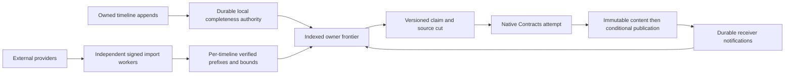

> Historical deployment report. The current isolated canonical preview and reproduction commands are in [canonical-preview.md](canonical-preview.md). These earlier timings and edition labels are not claims about the current build.

# AWS independent owners — 8 November 2026

## Status

Implemented and deployed local-authority timelines, imported external timelines, independent
acquisition, durable owner scheduling, and canonical native execution on the existing AWS console.
The published-clause journey has completed 156 Orders and seven Payments flowing back to the Agreement (`paidTotal: 1400`).
This is a working deployment, **not a claim that the millisecond performance target or arbitrary
historical graph migration is finished**. Exact measurements and limitations follow below.

Console: https://d2ya9daeiur7nz.cloudfront.net.

The implementation is in `myos-aws-test-better`, using `blue-java-better`. No Python source or
shared package release was changed. No GitHub operation was performed.

Final service artifact: `05c33d12f3e59e28b1e6b673ab0141dabb795ff1e7bfa112be29905a0cdd458a`.
SSM deployment `cc4fde00-577c-42b2-bed1-06914b60f5d4` completed successfully.
The public deployment record is `reports/owner-final-release.json`.

## Architecture and ordering

The system separates timeline acceptance/acquisition from document execution.

- Owned data-timeline appends and a per-account local exclusive completeness fence share a
  durable serialized authority. Provider access-control histories are still individually verified
  sources; they do not yet use this shortcut. Equal timestamps on different timelines are allowed.
- Each external timeline has a separately verified contiguous prefix and exclusive completeness
  bound. Manual import/retry, periodic acquisition and execution-driven demand use the same
  acquisition path. An existing sufficient bound avoids a network refresh for that candidate.
- A document selects the minimum original by timestamp, timeline identity, then entry identity.
  It cannot execute until every currently relevant source covers that timestamp. An external
  provider discovering an earlier entry causes that earlier original to be selected first.
- Acyclic documents own their processing independently. Initial strongly connected components
  are native units. Parents retain their own historical source cursors and edge lifetimes;
  they do not substitute a child's newest state. Removing an edge stops later application
  for that lifetime without stopping the independent child.
- A claim fixes the owner version, source cut and lease token. Native execution runs outside
  publication. A conditional account manifest publishes the result and scheduling deltas.
  Immutable pages are acknowledged before exposing references to them. Stale workers cannot
  replace newer heads; lost responses can be reconciled from protected publication records.
- Fresh execution sessions are reconstructed for attempts and then discarded. Bounded immutable
  caches are permitted; millions of document sessions do not have to remain resident.

Fast evidence consists of durable references to verified input cuts and protected native result
records. It can support later evidence assembly, but is not itself a portable zero-trust proof.
`docs/owner-frontiers.md` explains the storage boundary, algorithm, and test locations.

## External-provider qualification

The original provider located in the other chat used an older Coordination edition. The current
runtime correctly rejected its incompatible data. A separate current-edition qualification
provider is now running at https://dzkbzs1daaeut.cloudfront.net/api/provider. Its identity is
`7DJBMyNRGApCacxgJHvacD927xLfCPw46tNwDyTaBxZT`.

Two public timelines and one private timeline were created and imported through signed HTTPS.
Each contained an `amount: 7` entry. The private timeline required an explicit reader grant.
The provider has a separate process and endpoint but shares the test EC2 host; this establishes
protocol interoperability and isolation of acquisition, not independent-region availability.

The provider was also verified after the host recovery described below: it was healthy and retained
the same provider identity.

The mixed example replayed both public histories to `count: 14`, then a local operation reached
19. During a deliberate external-provider outage, another local operation remained pending
and the count stayed 19 because external coverage was insufficient. After restart it reached
24 automatically, approximately 7.69 seconds after the provider was started. This includes
reconnect and polling/backoff; it is not native computation time. Subsequent checks reached 29 and
then 34 after deployment/restart. The last local increment took 5,841 ms end to end, including
415 ms in the recorded root execution interval; this is not a millisecond end-to-end result.

Evidence: `reports/external-native-import.json`, `external-native-entries.json`,
`mixed-local-external.json`, and `external-outage.json`. Public test identifiers and import
commands are in `docs/owner-reproduction.md` and `examples/owners/mixed-timelines.blue`.

## Iterations kept and rejected

1. Ported the durable owner/frontier scheduler and local completeness authority to DynamoDB.
2. Added independently acquired external bounds, native provider-subtype verification, public
   timeline discovery, and private grant checks. Incompatible legacy protocol data stays rejected.
3. Fixed a late nonparticipation race: a claimed child proving an original unrelated must not
   reinsert that timestamp after its parent has already advanced.
4. Fixed immutable-page publication ordering. Separate reads during a multi-item transaction
   are not one atomic snapshot. Content is now durable before its manifest becomes visible;
   failure tests cover the publication boundary instead of hiding missing pages with retries.
5. Preserved unchanged address and operation projections and exact before-checkpoints, and
   retained incremental checkpoint export/publication against the existing content catalogue.
6. Implemented and parity-tested snapshot-pinned lazy lookup and protected preparation. Fixed
   public native views losing their resolver. The library API and regression tests are kept.
   The execution-side lazy/preparation combination was rejected after AWS measurements: ten
   additions near 141 Orders had a 5.62-second median, versus 4.35 seconds near 128 before it.
   Header batching also failed to improve that route. The retained host batches restoration
   and disables preparation and account-wide semantic facts on this rooted execution path.
7. Rejected speculative preparation-codec changes and eager root-opening changes. Also rejected
   a full-closure retention change in the library: it fetched unused workflow bodies and failed
   the lazy-workflow regression test. Protected validation facts are not evidence that another
   owner's content is available through the current snapshot's provider.

8. Removed full historical-catalogue enumeration from execution closure loading. Lookup follows
   current referenced identities through the persistent index. The regression test includes 1,024
   unrelated historical bodies and checks fewer than 32 physical index-page reads. This bounds
   historical lookup work; the AWS measurements below do not establish an end-to-end speedup.
9. Fixed newly created reader-key visibility: Secrets Manager can acknowledge creation before a
   subsequent read sees that immutable version. Retry only `ResourceNotFound` for the same
   pinned version, with six bounded backoff intervals (1.575 seconds total sleep). No new key is
   generated on the retry path. Persistent unavailability still fails safely and can resume using
   the original bootstrap command. Tests cover temporary invisibility, bounded failure and resume.

## Measurements and methodology

The final service runs on `m7i.large` (two vCPUs, 8 GiB), Java 25, a 2 GiB application heap,
DynamoDB storage, two acquisition workers and two receiver workers. Earlier real-clause numbers
were measured on `c7i.large` (two vCPUs, 4 GiB). This hardware change and differing graph sizes
mean the table is not a controlled before/after speedup experiment.

The root's `engineMillis` includes snapshot restoration, native admission and native execution.
It excludes publication and is not CPU-only; it also is not the sum of every child owner's time.
API latency includes signed submission, acquisition/scheduling, durable publication, propagation
and client polling. It excludes the preliminary operation-catalogue lookup; the JSON reports
also retain `observedWithLookupMillis`. No percentile claims are made from these small samples.

### Published Activation / Documents / Payment clauses

These use `IncrementalDocuments/Documents Clause` from the pinned package selection. Workflows
live in Blue documents; no Java handler implements Order or Payment business rules.

| Run | Measurement | End-to-end time |
|---|---|---:|
| Original growth run | Fresh Agreement bootstrap | 7,306 ms |
| Original growth run | Median of Orders 8–17 | 3,329 ms |
| Original growth run | Median of last ten additions through 128 Orders | 4,352 ms |
| Original growth run | Four operations creating/completing Payment 128 | 8,291–9,307 ms each |
| Rejected lazy/preparation candidate | Median of ten additions through 141 Orders | 5,622 ms |
| Retained batched restoration, before final indexed closure | Five warm additions through 153 | 5,411 ms median |
| Indexed closure, 8 GiB host | First large-document addition after restart (Order 154) | 20,125 ms |
| Indexed closure, 8 GiB host | Next additions (Orders 155 and 156) | 6,754 / 6,566 ms |
| Indexed closure, 8 GiB host | Prepare Payment 156 | 11,078 ms |
| Indexed closure, 8 GiB host | Accept instruction / report transfer / acknowledge | 10,429 / 9,862 / 10,165 ms |

The final large Agreement is
[available in the console](https://d2ya9daeiur7nz.cloudfront.net/#documents/graph-fast-b65952f8c4a604538afc2cf4d421256ef1f7c05ef99ffc4a).
It reached version 185, contains 156 Orders, and has a paid total of 1,400. Seven Orders have
completed Payments (1, 2, 128, 131, 147, 153 and 156); the others are unpaid. This is not a claim
that all 156 Orders have Payment children. Payment 156 and its Order were each verified at 200.

These results **do not meet the requested latency target**. The historical-index fix addresses
one source of unbounded work but does not remove rooted native processing. We have not proven
cold restored large-clause execution in milliseconds. The remaining root execution interval was
3.84–3.93 seconds for the two warm additions and 3.16–4.54 seconds for the Payment workflow.
There is additional storage, scheduling and child execution time outside that interval; this
report does not pretend the entire gap has been CPU-profiled or is attributable to proofs.

### Separate small native parity workload

This benchmark ran on a fresh, separate `c7i.xlarge` qualification worker (8 GiB). Its JVM was
limited to two CPUs, a 1 GiB heap and 1.5 GiB total memory. The instance was terminated after the
run. Four payment inputs were applied per graph size, with real DynamoDB storage.

| Graph | Durable initialization | Median Payment → Order → Agreement processing | Median root execution | Median signed acquisition |
|---|---:|---:|---:|---:|
| 1 Order + 1 Payment (3 documents) | 909 ms | 457 ms | 53 ms | 98 ms |
| 128 Orders, each with a Payment (257 documents) | 7,734 ms | 709 ms | 305 ms | 101 ms |

All eight inputs matched whole-native document identity, gas and completion receipt. Exactly
three owners published per input, with no unrelated owner publication. Gas was 2,363 versus
23,582 for the two sizes: exact canonical accounting still has graph-size costs.

**Cache qualification:** mutable execution sessions are fresh, but bounded immutable page
caches are warm from initialization, and the native oracle runs in the same JVM. These are
neither cold-storage nor console end-to-end measurements. The workload is intentionally simpler
than the full published-clause journey. It establishes bounded parity and durable propagation,
not the requested large-clause latency target or million-account capacity.

Evidence: `reports/owners-qualification-summary.json`, `clause-growth-final-128.json`,
`clause-restoration-warm-141.json`, `clause-final-153.json`, and `clause-closure-index-156.json`.

## Operational failure and recovery

An earlier attempt ran a qualification JVM on the same 4 GiB host as the live test service.
That was a deployment/testing mistake: memory pressure caused Linux OOM kills, taking down the
app and making the instance unresponsive. The run was cancelled. Reboot did not restore it;
force-stop, resize to `m7i.large` and start recovered it. The existing DynamoDB state and
EBS-backed provider identity survived. The recovered Agreement was verified at version 178,
paid total 1,200, and subsequently advanced to version 185 and total 1,400.

CloudFormation now records the 8 GiB capacity and reached `UPDATE_COMPLETE`. The replacement
qualification tool creates a separate clean worker, refuses the live host, limits JVM memory
and CPU, and terminates its own instance even on failure. Tests cover that boundary. This
prevents the same testing arrangement; it is not a claim of production high availability.

A final fresh bootstrap exposed a separate Secrets Manager visibility delay. AWS audit records
showed successful `CreateSecret` followed by `GetSecretValue` returning `ResourceNotFound`.
The bounded immutable-version retry above addresses this documented
[AWS eventual-consistency behavior](https://docs.aws.amazon.com/secretsmanager/latest/userguide/troubleshoot.html).
The failed command was retained for explicit retry rather than silently replaced by another one.
After deploying the fix, that same bootstrap completed in 8,884 ms. A separate fresh Agreement
then initialized in 3,908 ms and completed its full Order/Payment journey. All submitted originals
had APPLIED history, Payment/Order/Agreement totals reached 200, and participant timelines were
shared across all three levels. The five calls took 5,088 / 6,848 / 5,555 / 6,364 / 5,591 ms.
This small real-clause workload also misses the intended latency target.

Evidence: `reports/owner-bootstrap-visibility.json` and `reports/clause-final-small.json`.
[Open the final one-Order example](https://d2ya9daeiur7nz.cloudfront.net/#documents/graph-fast-d8621612e4d7e9a67338f378566419507fe279accd81de98).
The AWS retry proves preserved command identity and recovery; simulated visibility failures in
unit tests exercise the bounded retry directly. The fresh AWS run is not claimed to have forced
another provider-consistency delay.

## Local correctness evidence

The full Java verification passed **853 application tests and 2,615 library tests**, with zero
failures, errors or skips. Totals are recorded in `reports/owner-restoration-checks.json`. Eighteen
focused Python deployment-tool tests passed, including live-host refusal and temporary-worker
cleanup.

The verification compares independently reopened owner processing with whole native processing,
including exact document identity, gas, ordered emissions and completion receipt. It covers
1, 10 and 20 Orders, rejection followed by valid input, initial four/eight-member cycles,
canonical timestamp ties, removal/lifetimes, restart, lease fencing, concurrent publication,
invalid acquisition and mixed completeness. The real-clause test pays two distinct Orders
and creates a third, using the published Activation, Documents and Payment clauses.

## Remaining limitations

The receiver still runs a canonical rooted attempt. It reuses pure BEX calculations and immutable storage pages; it does not yet replace an entire child turn with a compact result while preserving
the shared canonical meter and rollback semantics. Consequently parent work and canonical gas
can grow with the reachable graph. Scheduling independently does not by itself eliminate this.

The account-wide conditional manifest serializes metadata publication for a hot account.
Arbitrary established SCC merge/split, and attaching incompatible old history behind an advanced
receiver, are explicitly rejected rather than silently reordered. Initial cycles and ordinary
forward attachment/removal are supported. Reclamation of unreachable immutable pages is separate
work. These are material limits: this iteration is not a proof of 100,000-node production scale.

To reach the requested target, the next substantial change is a native receiving optimization
with exact meter/event/rollback parity, then partitioned per-owner publication with durable
notification/outbox semantics and a defined historical/SCC migration protocol. Larger instances
alone do not remove those algorithmic costs.

## Reproduce

See `docs/owner-reproduction.md` for console operations, authenticated API scripts and external
imports. The script saves progress after every completed operation and stops on errors.
No tokens, passwords or private keys are included in this report.
